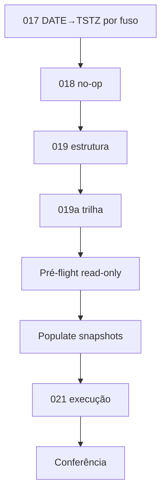

# Operação — correção de vigência TIMESTAMPTZ (fuso por empresa)

## Runbook por cenário

> **`scripts/migrate.js` e `scripts/reset-db.js` não são ferramentas de upgrade incremental** em banco já populado (staging/produção). Ambos reaplicam `schema.sql` e **todos** os arquivos em `migrations/` — use apenas os cenários abaixo.

### A) Banco novo reconstruído (dev / e2e)

| Passo | Artefato | Notas |
|-------|----------|-------|
| 1 | `node scripts/reset-db.js` | `DROP SCHEMA public` → `schema.sql` → **todos** os `.sql` em `migrations/` (ordem lexicográfica). |
| 2 | Migrations automáticas | Inclui **019 → 019a → 020 → 021** na mesma corrida. |
| 3 | **020 na corrida** | Executa **sem** elegíveis nem populate: em geral **NOTICE** (“nada a corrigir”). Isso **não** substitui a campanha operacional. |
| 4 | Seed / dados | Após reset (ex.: `scripts/seed-dev.js` ou e2e global-setup). |
| 5 | Pré-flight + revisão | `scripts/sql/preflight-vigencia-fuso-017-legacy.sql` (somente leitura). |
| 6 | Populate | `scripts/sql/populate-aprovacao-vigencia-fuso.sql` quando existirem elegíveis. |
| 7 | **021** | `psql … -f migrations/021_corretiva_vigencia_legado_fuso_idempotente.sql` — **única** execução que deve corrigir vigências com aprovação. |

**Não** confundir a passagem automática da 020/021 no reset com uma campanha em banco com dados: após o reset, a correção financeira só ocorre após **populate + 021 manual** (ou teste e2e equivalente).

### B) Banco existente que já executou 019 e a 020 antiga (b5dcbdb)

| Passo | Ação |
|-------|------|
| 1 | Verificar trilha: colunas `correcao_aplicada_em`, `lote_execucao` (`information_schema.columns`). |
| 2 | Se ausentes → `psql -f migrations/019a_vigencia_fuso_aprovacao_trilha.sql` (backfill conservador; **não** altera vigências já alinhadas). |
| 3 | Pré-flight (leitura) + revisão humana. |
| 4 | Populate validado. |
| 5 | **021** idempotente. |
| 6 | Conferência (pré-flight, DRE, baixas). |

**Proibido:** reaplicar `020_corretiva_vigencia_legado_fuso_exec.sql` (risco de lógica legada sem trilha e possível duplicidade de UPDATE em cenários limítrofes).

### C) Banco operacional novo (já em produção, sem reset) com dados existentes

| Passo | Ação |
|-------|------|
| 1 | Aplicar **somente** incrementais necessários (`017`…`019`, depois `019a`, **não** rerodar `schema.sql` inteiro). |
| 2 | **Não** executar `migrate.js` nem `reset-db.js` — ambos reaplicam **toda** a pasta + `schema.sql`. |
| 3 | Campanha: pré-flight → populate → **021** (arquivos `psql -f` individuais). |

**Por que não reaplicar a 020?** (1) Não há registro no banco de “já executada”; o arquivo no Git **não** se reaplica sozinho. (2) Ambientes que já rodaram a 020 antiga têm vigências possivelmente corrigidas; rerodar a 020 publicada ignora trilha idempotente e pode divergir do conjunto pendente/elegível atual. (3) A **021** é o artefato operacional pensado para pendentes + `correcao_aplicada_em`.

## Sequência real (obrigatória)

```text
017 (se ainda DATE)
    ↓
018 (no-op — manter numeração da cadeia)
    ↓
019 (estrutura: tabela + view; sem UPDATE)
    ↓
019a (trilha: correcao_aplicada_em / lote_execucao — incremental se 019 já existia)
    ↓
Pré-flight (SOMENTE LEITURA — não altera dados)
    ↓
Revisão humana
    ↓
populate / scripts/sql/populate-aprovacao-vigencia-fuso.sql
    ↓
021 (correção idempotente — artefato operacional)
    ↓
Conferência (pré-flight, DRE, baixas)
```



**Não é possível** inserir aprovações antes da **019**: a tabela `lexius_mig_vigencia_fuso_aprovacao` só existe depois dela.

| Etapa | Artefato | Altera vigências? |
|-------|----------|-------------------|
| 017 | `017_corretivas_dg_vigencia_estados.sql` | Pode (DATE→TSTZ) |
| 018 | `018_corretiva_vigencia_fuso_por_empresa.sql` | Não (vazio) |
| 019 | `019_vigencia_fuso_aprovacao_estrutura.sql` | Não |
| 019a | `019a_vigencia_fuso_aprovacao_trilha.sql` | Não |
| Pré-flight | `scripts/sql/preflight-vigencia-fuso-017-legacy.sql` | **Não** |
| Populate | `scripts/sql/populate-aprovacao-vigencia-fuso.sql` | Não |
| 020 | `020_corretiva_vigencia_legado_fuso_exec.sql` | Sim (versão **b5dcbdb** — não reexecutar em upgrade) |
| 021 | `021_corretiva_vigencia_legado_fuso_idempotente.sql` | Sim (restrito + trilha) |

## Papel de cada migration

- **019** — cria `lexius_mig_vigencia_fuso_aprovacao` e `lexius_vigencia_elegivel_correcao_fuso`.
- **Populate** — grava snapshots aprovados (empresa, origem, fuso, instantes, destinos). Remove apenas linhas **pendentes** (`correcao_aplicada_em IS NULL`); **não** apaga trilha concluída.
- **020 (publicada)** — versão em b5dcbdb; correção sem trilha idempotente. **Não** alterar no repositório; **não** reaplicar em bancos que já rodaram.
- **021** — valida conjunto **pendente** = elegível, snapshots completos e divergências; aplica `UPDATE`; marca `correcao_aplicada_em` e `lote_execucao`.

## Controle de execução (migrate.js / reset-db.js)

| Pergunta | Resposta |
|----------|----------|
| Como saber o que já rodou? | **Não há** tabela `schema_migrations`, checksum nem registro no Postgres. Controle é **manual/operacional** (runbook + evidência em ticket). |
| O que identifica cada passo? | **Nome do arquivo** aplicado via `psql -f` ou scripts Node. |
| A 020 do b5dcbdb “está registrada”? | **Não** no banco. Se foi executada, foi decisão operacional; o Git **não** dispara reexecução. |
| Nova lógica após 019a? | `psql … -f migrations/021_corretiva_vigencia_legado_fuso_idempotente.sql` (e populate validado). **Não** substituir o arquivo 020 no disco e esperar reapply automático. |
| Substituir conteúdo da 020 basta? | **Não.** Bancos existentes não releem a pasta `migrations/` incrementalmente — por isso existe a **021** nova. |
| Evitar correção antiga duplicada | Quem já rodou **020** antiga: só **019a** (trilha/backfill) + **021**; **não** rodar 020 de novo. |

`migrate.js` / `reset-db.js`: `readdir` + `.sort()` + `client.query(arquivoInteiro)` — **um round-trip por arquivo**, sem transação Node envolvendo o lote. Transação SQL é a do próprio `.sql` (`BEGIN`/`COMMIT`).

## Idempotência da 021 (sem apagar auditoria)

| Situação | Comportamento |
|----------|----------------|
| 0 elegíveis, 0 pendentes, 0 concluídos | NOTICE: nada a fazer |
| 0 elegíveis, aprovações **concluídas** (`correcao_aplicada_em` preenchido) | NOTICE: operação já concluída (**repetição segura**) |
| 0 elegíveis, aprovações **pendentes** | **EXCEPTION** (órfãs — não ignora) |
| Elegíveis + conjunto pendente divergente | **EXCEPTION** (rollback integral) |
| Nova rodada após sucesso | Novo elegível → novo populate (pendentes) → nova **021**; linhas antigas **permanecem** com `correcao_aplicada_em` |

Snapshots já concluídos **não** podem ser sobrescritos (`ON CONFLICT … WHERE correcao_aplicada_em IS NULL` no populate/helpers).

## Snapshots obrigatórios

`empresa_id_aprovado`, `origem_aprovada`, `fuso_negocio_aprovado`, `valido_de_aprovado`, `valido_ate_aprovado`, `novo_valido_de_aprovado`, `novo_valido_ate_aprovado` (quando aplicável).

## Divergências

| Mensagem | Ação |
|----------|------|
| `Divergência entre elegíveis e aprovados` | Ajustar conjunto pendente |
| `Aprovação incompleta` | Repopular com script completo |
| `snapshot aprovado e vigência/empresa atual` | Novo pré-flight + populate |
| `Aprovações pendentes sem vigências elegíveis` | Corrigir populate ou remover apenas pendentes inválidos (não apagar concluídos) |

## TypeORM vs SQL

Migrations em `migrations/*.sql` são aplicadas por `scripts/migrate.js` / `scripts/reset-db.js`. O NestJS **não** executa essa cadeia via `TypeOrmModule.migrations`.